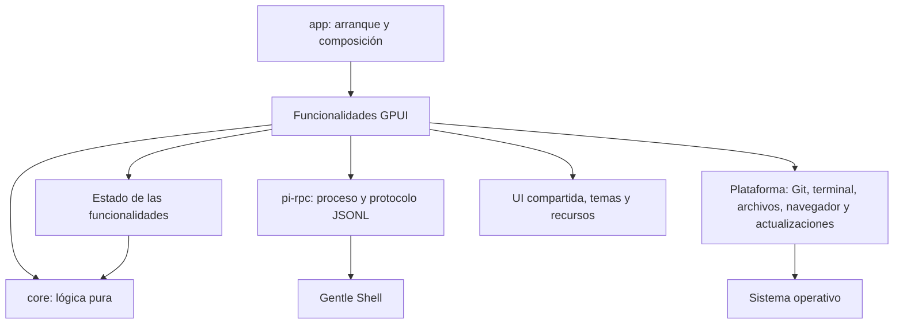
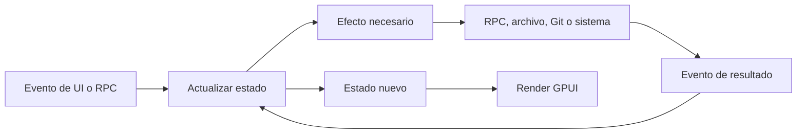

# Arquitectura

Gentle Shell GPUI es una aplicación de escritorio nativa escrita en Rust. Su arquitectura es un **monolito modular por funcionalidades**: se despliega como una sola aplicación, pero mantiene fronteras explícitas entre la interfaz, la lógica pura y las integraciones externas.

## Objetivos

- Mantener el comportamiento observable durante los refactors.
- Hacer que cada funcionalidad tenga una API pública pequeña y detalles internos privados.
- Separar las reglas y transformaciones puras de GPUI, procesos, archivos y APIs del sistema operativo.
- Evitar abstracciones sin una necesidad actual: no se crea un crate por pantalla ni un trait con una sola implementación sólo para simular desacoplamiento.
- Permitir pruebas deterministas de estado, transiciones, parsers y casos límite.

## Componentes actuales



| Componente | Responsabilidad |
| --- | --- |
| `crates/app` | Binario, composición, estado de las funcionalidades, vistas GPUI y los efectos (archivos, procesos, sonido) de la lógica que vive en `core`. |
| `crates/core` (`gentle-core`) | Lógica pura sin GPUI ni IO: modelos del transcript y de la actividad de subagentes, resúmenes de herramientas, modo de permisos, jobs y fase ODD, enrutado de comandos `/`, política de `notifications.json`, modelos de uso y estadísticas, y el modelo de perfiles y enrutado de modelos. |
| `crates/pi-rpc` | Resolución y lanzamiento del backend, transporte JSONL, autenticación y tipos del protocolo. |
| `packaging` | Empaquetado e integración de distribución por sistema operativo. |

`crates/pi-rpc` es una frontera estable: no conoce GPUI, ventanas, pestañas ni componentes visuales. `crates/app` depende de él, nunca al contrario.

`crates/core` no depende de nada del proyecto (ni de `app` ni de `pi-rpc`) ni de GPUI; sus únicas dependencias son `serde`, `serde_json` y `regex`. Compila igual en macOS, Windows y Linux: no contiene código específico de plataforma salvo la sintaxis de rutas `file:` de la política, elegida con `cfg!(windows)` en compilación. Cuando un módulo mezclaba lógica pura y efectos, la parte pura vive en `core` y la parte con efectos queda en `app` y la llama:

| `core` | Queda en `app` |
| --- | --- |
| `transcript`, `activity`, `tools`, `commands` | `session/agents.rs`: `now_ms` (reloj del sistema). |
| `gentle_state`: `PermissionMode`, jobs, inferencia de fase | `gentle_state.rs`: leer y guardar `permission-mode.json`. |
| `notifications`: `Alert`, validación y cambios de la política | `alerts.rs`: caché y escritura del archivo, reproducción, aviso a la ventana, `Gate` y `ContextLatch`. |
| `text::first_line` | `ui.rs`: el resto de utilidades de presentación. |
| `usage`: modelos y parsers de ventanas de suscripción (Codex, NaN), agrupación, claim de cuenta; registros de sesión, agregación de estadísticas, fechas ISO y días civiles | `usage/`: leer `auth.json`, resolver claves (`$VAR`, `!comando`), peticiones HTTP, recorrer y cachear archivos de sesión, reloj y desplazamiento horario local. |
| `profiles`: modelo de enrutado, formato de `profiles.json`, pins, frontmatter de agentes, notas | `profiles/`: homes y descubrimiento de agentes, escrituras atómicas, enrutado guardado y materializado, settings de Pi, archivos de pin y worktree, Make default. |

## Organización objetivo

La migración es incremental. La estructura objetivo no obliga a mover código que todavía cambia junto o cuya separación añadiría ceremonia.

```text
crates/
├── app/
│   └── src/
│       ├── main.rs              # arranque: CLI, instancia única, PATH de toolchains, adopción de config
│       ├── app.rs               # composition root: GPUI, temas, atajos, menús y ventana
│       ├── cli.rs               # argumentos (`[FOLDER] [-p TEXT]`) y carpeta inicial
│       ├── session/             # conversación y backend de una pestaña
│       ├── files/               # árbol, cambios, referencias y visor
│       ├── setup/               # comprobaciones e instalación
│       ├── terminal/            # PTY y presentación de terminal
│       ├── platform.rs          # ícono del Dock (macOS) y de la ventana (X11); crece a platform/ cuando compense
│       └── shared/              # UI reutilizable sin estado de negocio, cuando compense
├── core/                        # lógica pura compartida (gentle-core)
└── pi-rpc/
```

`core` crece por comportamiento completo y sólo con lógica pura; lo que necesite IO, procesos, reloj o GPUI se queda en `app` y llama a `core`. No se introducen traits ni adaptadores para poder mover algo a `core`.

## Anatomía de una funcionalidad

Una funcionalidad grande puede dividirse por responsabilidad:

```text
feature/
├── mod.rs          # API pública y coordinación
├── state.rs        # estado y modelos propios
├── update.rs       # transiciones puras, si existen
├── effects.rs      # procesos, red, archivos y tareas asíncronas
└── view/           # render y estado exclusivamente visual
```

Esta forma es una guía, no una plantilla obligatoria. Una funcionalidad pequeña debe seguir siendo un solo módulo.

### Frontera actual de la sesión

`SessionView` es una pestaña: un backend `gentle-shell --mode rpc` y su conversación. Su lógica se divide por responsabilidad en bloques `impl SessionView` de módulos hermanos; `session/mod.rs` conserva la estructura, el constructor, la API pública que usa la ventana (`workspace.rs`), los avisos a la ventana (`SessionEvent`, `sync_chrome`), las acciones y el cableado de módulos:

```text
session/
├── mod.rs          # SessionView, constructor, API pública, acciones y utilidades de ventana
├── state.rs        # grupos de campos que cambian juntos y sus transiciones puras
├── events.rs       # eventos RPC, peticiones de UI de extensiones, stderr/salida y refrescos de Git
├── rpc.rs          # petición/respuesta, estado leído del backend y comandos (modelo, compactar, exportar, sesiones, prompts)
├── lifecycle.rs    # arranque, reinicio (ahora o al terminar el turno), reanudación y reinicio de la conversación
├── submit.rs       # envío del compositor: `!` shell, built-ins, pantallas nativas y adjuntos
├── agents.rs       # panel de agentes
├── builtins.rs     # clasificación de comandos y captura de salidas de extensiones (puro)
├── attachments.rs  # validación, tokens y carga útil de imágenes (puro)
└── view.rs, view/  # render (ver más abajo)
```

`state.rs` agrupa el backend y su ciclo de vida (`Backend`: estado del proceso, versión, stderr, prompt y sesión pendientes, reinicio pendiente), los modelos y el nivel de pensamiento (`Models`), uso y compactación (`Usage`), la UI de extensiones (`ExtensionUi`: diálogos, estados, widgets, límites de uso y toasts recientes), la actividad del turno (`TurnActivity`: fase, cola, jobs y ayudantes), la isla de tareas (`TodoIsland`) y el estado de Git (`GitStatus`). Las interpretaciones de eventos que no necesitan GPUI (fase y jobs de una llamada a herramienta, recuento de la cola, lienzo de Gentle Design, nivel de un `notify`) son funciones o métodos puros con pruebas en `events.rs`; los efectos (peticiones, temporizadores, notificaciones) quedan en los métodos de `SessionView`.

### Frontera actual de la vista de sesión

`session/view.rs` conserva la composición (`Render`), la sincronización de lo derivado de la conversación (`sync_view`, Markdown renderizado), el render de los elementos de la conversación (tarjetas de herramientas, pensamiento, mensajes, avisos) y las piezas compartidas por varias vistas. Cada responsabilidad visual del compositor y de la conversación vive en un módulo hijo que sólo expone a la vista la API que ésta necesita:

```text
session/
├── view.rs                   # Render, filas de la conversación y piezas compartidas
└── view/
    ├── live.rs               # temporizadores y estado visual transitorio
    ├── transcript_list.rs    # filas, mediciones y cachés de la lista virtualizada
    ├── cards.rs              # tarjetas de mensajes personalizados de extensiones
    ├── composer.rs           # compositor: línea de contexto, adjuntos, texto y barra inferior
    ├── activity.rs           # línea de actividad y chips de estado (jobs, widgets, uso, ayudantes, límites)
    ├── slash_menu.rs         # menú de comandos `/` y su teclado
    ├── model_picker.rs       # selector de modelo, búsqueda y teclado
    ├── effort.rs             # control de esfuerzo (nivel de pensamiento) y su deslizador
    ├── permissions.rs        # chip y selector del modo de permisos
    ├── dialogs.rs            # diálogos de extensiones y su teclado
    └── todo_island.rs        # isla de tareas sobre la conversación
```

`transcript_list.rs` es dueño de la forma de las filas, el cálculo de actualizaciones parciales, la caché de datos preparados y el estado de la lista GPUI. `view.rs` decide qué contenido renderizar para cada fila, pero no modifica directamente la estructura interna de la lista.

Los módulos hijos añaden bloques `impl SessionView` propios; lo que otro módulo consume se marca `pub(super)` y lo que usa `session/mod.rs` se marca `pub(in crate::session)` o se reexporta desde `view.rs`. Las constantes de anchura (`NARROW`, `TINY`), los plegados y las piezas compartidas (`clock`, `image_tile`, `number_badge`) permanecen en `view.rs`.

### Otras funcionalidades divididas

Cada una conserva su tipo público y su API en el archivo padre; los hijos agregan bloques `impl` propios y marcan `pub(super)` lo que comparten.

```text
workspace.rs        # Workspace, tipos (Pane, Tab, Space, Overlay) y API pública
workspace/
├── layout.rs       # cálculos de división de paneles
├── panes.rs        # crear, dividir, enfocar y cerrar paneles
├── spaces.rs       # workspaces con nombre
├── tabs.rs         # pestañas y renombrado
├── persistence.rs  # snapshot y guardado
├── actions.rs      # manejadores de atajos
├── overlays.rs     # pantallas superpuestas, paleta, navegador y animación max
├── view.rs         # barra de título, pestañas y paneles
└── render.rs       # impl Render

profiles.rs         # ProfilesView, ProfilesEvent, estado y consultas
profiles/
├── env.rs          # homes, paquete gentle-pi y descubrimiento de agentes
├── files.rs        # escrituras atómicas, profiles.json, models.json, settings.json, carga
├── pins.rs         # pins del repositorio (archivos y worktree Git)
├── apply.rs        # materialización de rutas, orquestador y Make default
├── draft.rs        # ediciones del borrador (modelo, esfuerzo, tier)
├── actions.rs      # acciones del store y flujos de salida, nombre y borrado
├── tests.rs        # pruebas de efectos de archivo
└── view.rs, view/  # Render; cells, table, profile_list, confirm, footer

usage.rs            # UsageView, estado, refrescos y API pública
usage/
├── credentials.rs  # auth.json → tarjetas y peticiones; resolución de claves
├── fetch.rs        # peticiones HTTP de uso
├── stats.rs        # archivos de sesión: recorrido, lectura, caché
└── view.rs, view/  # Render; subscription, stats

settings.rs         # SettingsView, SettingsEvent, carga y composición de la pantalla
settings/
├── layout.rs       # row, section, or_dash
├── snapshot.rs     # lectura de la configuración y sondas del lanzador
├── claude.rs       # sesión de Claude Code y plan del bridge
├── background.rs   # política de background subagents y sección Gentle AI
├── upgrade.rs      # gentle-shell upgrade, su resultado y la tarjeta
├── packages.rs     # instalar y quitar paquetes
└── notifications.rs, theme.rs, app.rs, models.rs  # una sección cada uno
```

## Flujo de datos



Los efectos no deben esconder cambios de estado. Los resultados vuelven a la funcionalidad para que ésta decida cómo representarlos.

## Reglas de dependencias

1. `pi-rpc` **no depende** de `app` ni de GPUI.
2. `app` puede depender de `pi-rpc` y de `core`; la dirección inversa está prohibida.
3. `core` **no depende** de nada del proyecto (`app`, `pi-rpc`) ni de GPUI, filesystem, procesos, reloj ni APIs del sistema.
4. Una funcionalidad consume otra mediante su API pública; no accede a sus módulos privados.
5. El código compartido de UI no contiene reglas de negocio ni conoce funcionalidades concretas.
6. La integración con sistema operativo, procesos y archivos permanece en los bordes.
7. Los tipos se mantienen privados salvo que formen parte de un contrato real entre módulos.
8. No se introduce un trait hasta que exista una frontera que necesite sustitución, varias implementaciones o una prueba que no pueda resolverse con una función pura.
9. Dividir un archivo por tamaño no basta: cada módulo extraído debe tener una responsabilidad nombrable y cohesiva.
10. Todo refactor conserva comportamiento. Cuando el comportamiento no esté protegido, primero se añade una prueba de caracterización relevante.

## Estrategia de pruebas

- **Lógica pura:** pruebas unitarias de transiciones, precedencia, límites y errores.
- **Parsers y protocolo:** entradas representativas, datos incompletos y registros inválidos.
- **Integraciones:** pruebas en el borde o una prueba de humo que ejecute el camino real.
- **UI:** probar el estado y las decisiones observables; no probar que una función simplemente delega o copia campos.

Antes de completar una etapa se ejecutan formato, pruebas, Clippy y una prueba de humo de la ruta modificada. Si el entorno no permite una comprobación, se documenta explícitamente; no se supone que pasó.

## Cómo agregar una funcionalidad

1. Encontrar la funcionalidad dueña del comportamiento.
2. Colocar allí estado, eventos y vista mientras sean cohesivos.
3. Extraer lógica pura a un módulo propio cuando pueda probarse sin GPUI ni IO.
4. Usar `pi-rpc` o un módulo de plataforma para efectos externos; no duplicar el transporte o la detección del sistema.
5. Exponer desde `mod.rs` sólo lo que consuman otros módulos.
6. Añadir pruebas que cubran comportamiento susceptible de regresión.
7. Actualizar este documento o crear un ADR si cambia una frontera o una regla de dependencias.

## Decisiones relacionadas

- [ADR-0001: monolito modular por funcionalidades](adr/0001-monolito-modular.md)
- [ADR-0002: núcleo puro incremental](adr/0002-nucleo-puro-incremental.md)
- [ADR-0003: refactors con conservación de comportamiento](adr/0003-refactors-sin-cambio-funcional.md)
