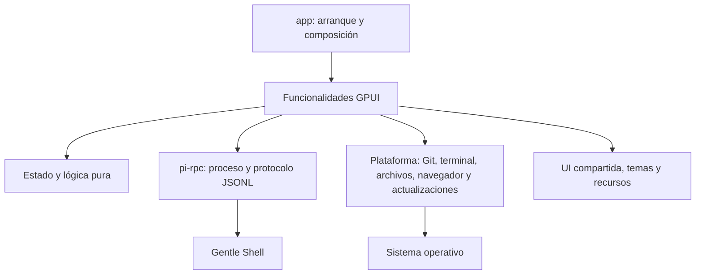
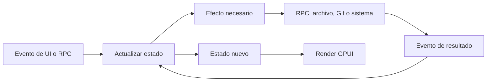

# Arquitectura

Gentle Shell GPUI es una aplicación de escritorio nativa escrita en Rust. Su arquitectura es un **monolito modular por funcionalidades**: se despliega como una sola aplicación, pero mantiene fronteras explícitas entre la interfaz, la lógica pura y las integraciones externas.

## Objetivos

- Mantener el comportamiento observable durante los refactors.
- Hacer que cada funcionalidad tenga una API pública pequeña y detalles internos privados.
- Separar las reglas y transformaciones puras de GPUI, procesos, archivos y APIs del sistema operativo.
- Evitar abstracciones sin una necesidad actual: no se crea un crate por pantalla ni un trait con una sola implementación sólo para simular desacoplamiento.
- Permitir pruebas deterministas de estado, transiciones, parsers y casos límite.

## Componentes actuales



| Componente | Responsabilidad |
| --- | --- |
| `crates/app` | Binario, composición, estado de las funcionalidades y vistas GPUI. |
| `crates/pi-rpc` | Resolución y lanzamiento del backend, transporte JSONL, autenticación y tipos del protocolo. |
| `packaging` | Empaquetado e integración de distribución por sistema operativo. |

`crates/pi-rpc` es una frontera estable: no conoce GPUI, ventanas, pestañas ni componentes visuales. `crates/app` depende de él, nunca al contrario.

## Organización objetivo

La migración es incremental. La estructura objetivo no obliga a mover código que todavía cambia junto o cuya separación añadiría ceremonia.

```text
crates/
├── app/
│   └── src/
│       ├── main.rs              # composition root
│       ├── session/             # conversación y backend de una pestaña
│       ├── files/               # árbol, cambios, referencias y visor
│       ├── setup/               # comprobaciones e instalación
│       ├── terminal/            # PTY y presentación de terminal
│       ├── platform/            # integración específica del SO, cuando compense
│       └── shared/              # UI reutilizable sin estado de negocio, cuando compense
├── core/                        # lógica pura compartida, sólo cuando exista una frontera real
└── pi-rpc/
```

No es necesario crear `core` antes de disponer de lógica pura que sea reutilizable y esté libre de tipos GPUI e IO. Hasta entonces, esa lógica puede permanecer en módulos puros dentro de `app`.

## Anatomía de una funcionalidad

Una funcionalidad grande puede dividirse por responsabilidad:

```text
feature/
├── mod.rs          # API pública y coordinación
├── state.rs        # estado y modelos propios
├── update.rs       # transiciones puras, si existen
├── effects.rs      # procesos, red, archivos y tareas asíncronas
└── view/           # render y estado exclusivamente visual
```

Esta forma es una guía, no una plantilla obligatoria. Una funcionalidad pequeña debe seguir siendo un solo módulo.

### Frontera actual de la vista de sesión

`session/view.rs` conserva la composición y el render de la conversación. Sus responsabilidades visuales con estado propio se extraen como módulos hijos y sólo exponen a la vista la API que ésta necesita:

```text
session/
├── view.rs
└── view/
    ├── live.rs               # temporizadores y estado visual transitorio
    └── transcript_list.rs    # filas, mediciones y cachés de la lista virtualizada
```

`transcript_list.rs` es dueño de la forma de las filas, el cálculo de actualizaciones parciales, la caché de datos preparados y el estado de la lista GPUI. `view.rs` decide qué contenido renderizar para cada fila, pero no modifica directamente la estructura interna de la lista.

## Flujo de datos



Los efectos no deben esconder cambios de estado. Los resultados vuelven a la funcionalidad para que ésta decida cómo representarlos.

## Reglas de dependencias

1. `pi-rpc` **no depende** de `app` ni de GPUI.
2. `app` puede depender de `pi-rpc`; la dirección inversa está prohibida.
3. La lógica candidata a `core` no depende de GPUI, `pi-rpc`, filesystem, procesos ni APIs del sistema.
4. Una funcionalidad consume otra mediante su API pública; no accede a sus módulos privados.
5. El código compartido de UI no contiene reglas de negocio ni conoce funcionalidades concretas.
6. La integración con sistema operativo, procesos y archivos permanece en los bordes.
7. Los tipos se mantienen privados salvo que formen parte de un contrato real entre módulos.
8. No se introduce un trait hasta que exista una frontera que necesite sustitución, varias implementaciones o una prueba que no pueda resolverse con una función pura.
9. Dividir un archivo por tamaño no basta: cada módulo extraído debe tener una responsabilidad nombrable y cohesiva.
10. Todo refactor conserva comportamiento. Cuando el comportamiento no esté protegido, primero se añade una prueba de caracterización relevante.

## Estrategia de pruebas

- **Lógica pura:** pruebas unitarias de transiciones, precedencia, límites y errores.
- **Parsers y protocolo:** entradas representativas, datos incompletos y registros inválidos.
- **Integraciones:** pruebas en el borde o una prueba de humo que ejecute el camino real.
- **UI:** probar el estado y las decisiones observables; no probar que una función simplemente delega o copia campos.

Antes de completar una etapa se ejecutan formato, pruebas, Clippy y una prueba de humo de la ruta modificada. Si el entorno no permite una comprobación, se documenta explícitamente; no se supone que pasó.

## Cómo agregar una funcionalidad

1. Encontrar la funcionalidad dueña del comportamiento.
2. Colocar allí estado, eventos y vista mientras sean cohesivos.
3. Extraer lógica pura a un módulo propio cuando pueda probarse sin GPUI ni IO.
4. Usar `pi-rpc` o un módulo de plataforma para efectos externos; no duplicar el transporte o la detección del sistema.
5. Exponer desde `mod.rs` sólo lo que consuman otros módulos.
6. Añadir pruebas que cubran comportamiento susceptible de regresión.
7. Actualizar este documento o crear un ADR si cambia una frontera o una regla de dependencias.

## Decisiones relacionadas

- [ADR-0001: monolito modular por funcionalidades](adr/0001-monolito-modular.md)
- [ADR-0002: núcleo puro incremental](adr/0002-nucleo-puro-incremental.md)
- [ADR-0003: refactors con conservación de comportamiento](adr/0003-refactors-sin-cambio-funcional.md)
